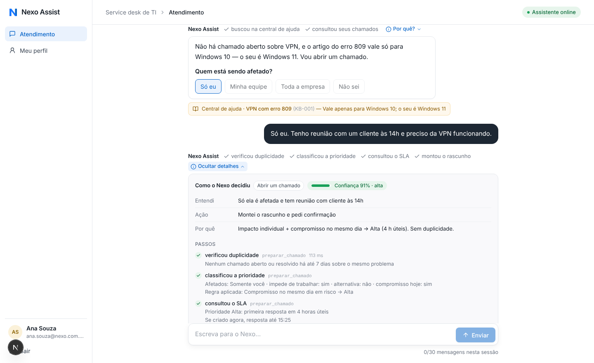
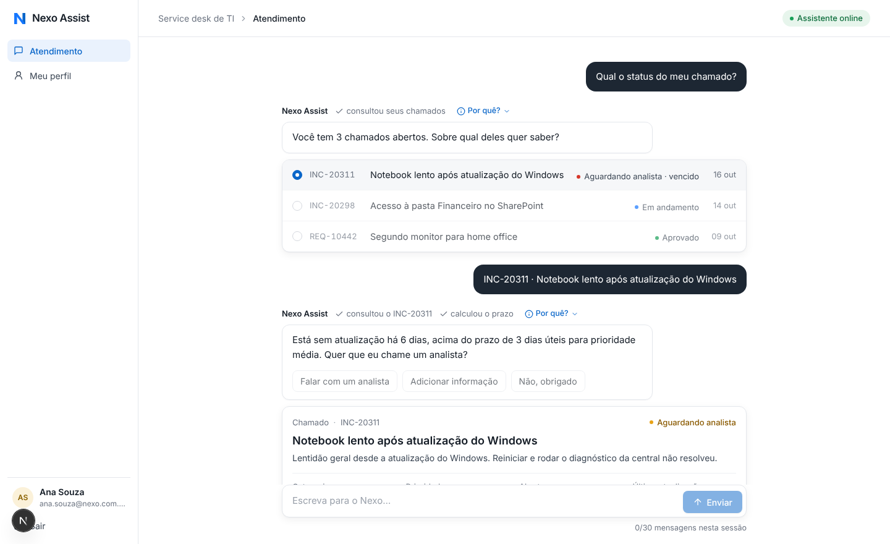
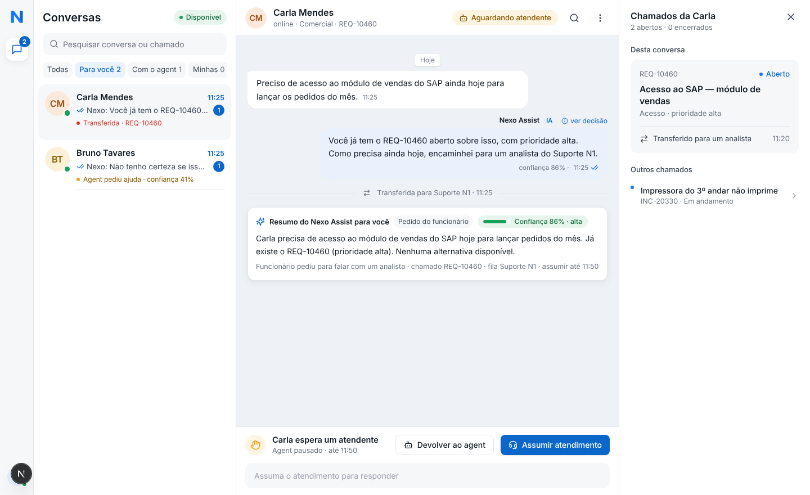
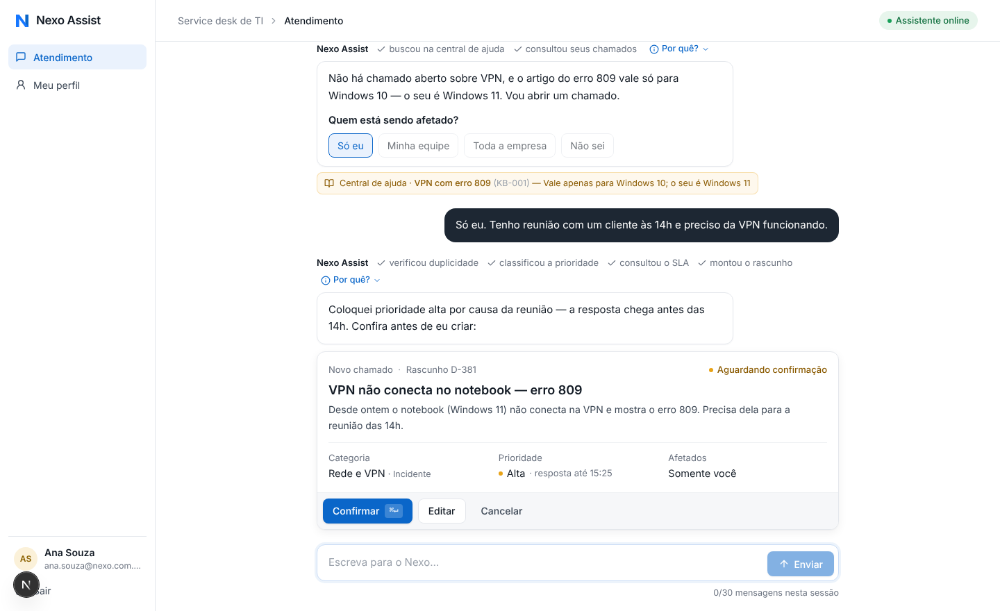
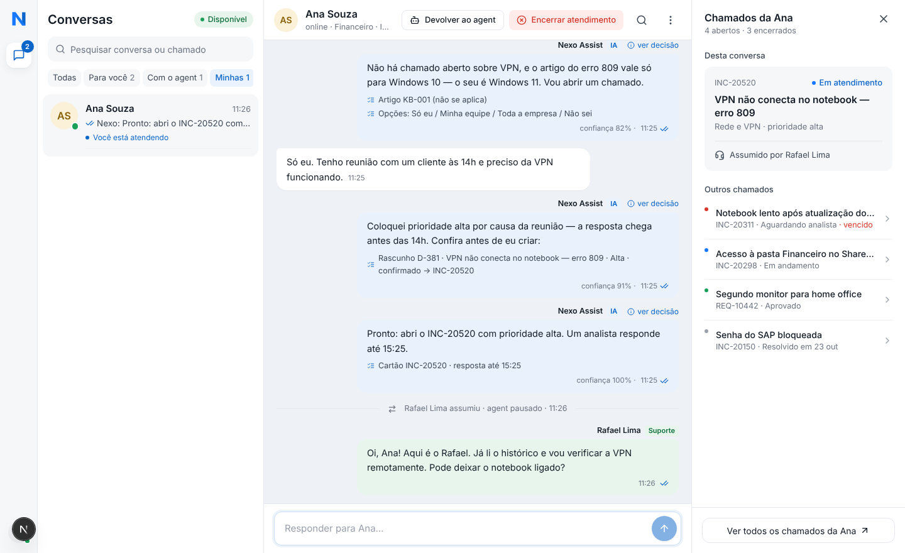
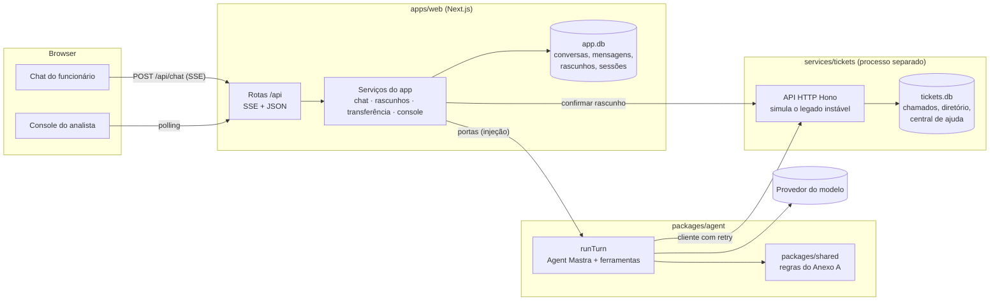

# Nexo Assist — agent do service desk de TI

O funcionário descreve o problema num chat e o **Nexo Assist** decide o que fazer: responder uma dúvida pela central de ajuda, consultar ou complementar um chamado, abrir um chamado novo (com rascunho para conferir) ou chamar um analista. Do outro lado, o **console do analista** mostra as conversas que precisam de uma pessoa, com o resumo do caso e o detalhe de cada decisão do agent.



| Funcionário | Analista |
|---|---|
|  |  |
|  |  |

---

## Sumário

1. [Como rodar](#como-rodar)
2. [Visão geral da arquitetura](#visão-geral-da-arquitetura)
3. [Como o agent decide o que fazer](#como-o-agent-decide-o-que-fazer)
4. [Transparência: ver o que o agent fez e por quê](#transparência-ver-o-que-o-agent-fez-e-por-quê)
5. [Como garanti a qualidade das decisões](#como-garanti-a-qualidade-das-decisões)
6. [Modelo, custo e eficiência](#modelo-custo-e-eficiência)
7. [Segurança, privacidade e resiliência](#segurança-privacidade-e-resiliência)
8. [Principais trade-offs](#principais-trade-offs)
9. [O que eu faria com mais tempo](#o-que-eu-faria-com-mais-tempo)
10. [Deploy](#deploy)
11. [Onde cada requisito do PRD está](#onde-cada-requisito-do-prd-está)

---

## Como rodar

**Pré-requisitos:** Node.js 22.9+ (há um `.nvmrc`) e uma chave de API da Anthropic (ou de outro provedor — veja [Modelo](#modelo-custo-e-eficiência)).

```bash
cp .env.example .env          # preencha ANTHROPIC_API_KEY
npm install
npm run dev                   # sobe o serviço de chamados (:4000) e o app (:3000)
```

Abra **http://localhost:3000**. O login aceita os funcionários dos dados de exemplo com **qualquer senha** — a própria tela de login tem atalhos:

| Conta | Perfil | Para testar |
|---|---|---|
| `ana.souza@nexo.com.br` | Funcionária · Windows 11 | chamado vencido (INC-20311), VPN erro 809 (artigo não se aplica), SAP resolvido há 4 dias (reabrir) |
| `carla.mendes@nexo.com.br` | Funcionária · Windows 10 | VPN erro 809 (artigo se aplica), chamados de outra pessoa (privacidade) |
| `bruno.tavares@nexo.com.br` | Funcionário · macOS | |
| `rafael.lima@nexo.com.br` | Analista · Suporte N2 | console do analista |
| `juliana.costa@nexo.com.br` | Analista · Suporte N1 | console do analista |

Abra o funcionário e o analista em janelas diferentes (ou uma anônima) para ver a transferência acontecendo dos dois lados.

### Comandos

| Comando | O que faz |
|---|---|
| `npm run dev` | Desenvolvimento (serviço de chamados + app, com reload) |
| `npm run build && npm start` | Produção local |
| `npm test` | Testes (regras, serviço de chamados, agent de ponta a ponta, serviços do app) — não precisam de chave |
| `npm run eval` | Avaliação das decisões com o **modelo real** (13 cenários; precisa da chave) |
| `npm run typecheck` | TypeScript estrito em todos os pacotes |
| `npm run reset` | Apaga os bancos e recria os dados de exemplo |
| `docker compose up --build` | Sobe tudo num contêiner com volume para os dados |

> Os dados de exemplo usam datas **relativas ao dia do primeiro start** (ex.: INC-20311 "sem atualização há 6 dias"), para que os cenários de prazo vencido e reabertura funcionem em qualquer dia. Use `npm run reset` para recriá-los.

---

## Visão geral da arquitetura



```
nexo-assist/
├── apps/web/                 # Next.js 16: telas, rotas /api e serviços do app
│   └── src/
│       ├── app/              # páginas (login, atendimento, perfil, console) e rotas /api
│       ├── components/       # chat, cartões, painel de decisão, console
│       └── server/           # store (SQLite), serviços, composição, limites
├── packages/
│   ├── agent/                # o Nexo Assist: prompt, ferramentas, trilha, guardrails, evals
│   └── shared/               # domínio e regras do service desk (puro, testado)
└── services/tickets/         # serviço de chamados simulado (HTTP + SQLite + cliente tipado)
```

**Por que assim:**

- **Três camadas separadas, como pede o PRD.** A interface não fala com o modelo nem com o sistema de chamados; o agent não conhece banco nem HTTP de entrada (recebe *portas* injetadas); o serviço de chamados é um **processo separado** com API própria, como seria o legado real.
- **Regras de negócio em código, não no prompt.** Prioridade, prazo em horário útil, duplicidade, reabertura em 7 dias e privacidade ficam em `packages/shared` e no serviço de chamados — determinísticos e testados. O modelo extrai fatos da conversa; o código decide. Isso é o que torna as decisões consistentes *e* explicáveis.
- **Confirmar é uma ação do sistema, não do modelo.** O agent só *monta rascunhos*. Quem cria/atualiza o chamado é o botão **Confirmar** (ou uma confirmação por texto validada por código). Não existe ferramenta que o modelo possa chamar para criar um chamado sem confirmação.
- **Cada serviço é dono dos seus dados.** `app.db` (conversas) e `tickets.db` (chamados) são bancos diferentes; o app nunca lê o banco de chamados diretamente.
- **TypeScript estrito** (`strict`, `noUncheckedIndexedAccess`) em todo o monorepo, com npm workspaces e pacotes consumidos como fonte TS.

---

## Como o agent decide o que fazer

Um turno (`packages/agent/src/run-turn.ts`):

1. **Contexto.** Instruções fixas (estáveis entre turnos) + contexto do turno: data/hora em Brasília, funcionário (área, equipamento, **sistema operacional**), chamado em foco e rascunhos pendentes.
2. **Histórico compacto.** Últimas 16 mensagens; cartões de turnos anteriores viram uma linha (`[rascunho D-381 — … — aguardando confirmação]`) em vez de JSON de ferramenta. Mensagens de analista e eventos de sistema entram marcados.
3. **Loop do agent (Mastra)** com as ferramentas abaixo, até 8 passos, streaming do texto e de cada passo para a tela.
4. **Regras pós-modelo (guardrails)**: se o modelo não registrou a decisão, o sistema infere e avisa; se a confiança ficou abaixo de 40% sem informação faltando, a conversa é transferida automaticamente para um analista (regra "quando o agent não tem segurança").
5. **Persistência** da resposta com os cartões e a trilha completa.

### Ferramentas

| Ferramenta | Quando o agent usa | O que o **código** garante |
|---|---|---|
| `buscar_central_ajuda` | Dúvidas e antes de abrir chamado | Busca por relevância; marca se o artigo **se aplica ao SO** do funcionário (ex.: erro 809 só no Windows 10) |
| `listar_meus_chamados` | "Como está meu chamado?" sem número; checar duplicidade | Só os chamados do funcionário autenticado; prazo calculado |
| `consultar_chamado` | Com número (ou após a escolha na lista) | Chamado de outra pessoa = "não encontrado" (nem a existência vaza); prazo/vencimento calculados |
| `preparar_chamado` | Dados completos para um chamado novo | Duplicidade (aberto ou resolvido ≤ 7 dias) **bloqueia** o rascunho; **prioridade e prazo calculados pela matriz do Anexo A** a partir dos fatos informados |
| `preparar_complemento` | Acrescentar informação ou reabrir | Aberto → complemento; resolvido ≤ 7 dias → reabertura; mais antigo → recusa |
| `confirmar_rascunho` | Funcionário confirmou por texto | Só executa se a última mensagem for uma confirmação clara (regex de afirmação sem negação) |
| `transferir_para_analista` | Pedido, crítico, vencido ou sem segurança | Fila (N1/N2) e prazo para assumir definidos por regra; agent pausa |
| `oferecer_opcoes` | Pergunta com respostas previsíveis | Botões de resposta rápida |
| `registrar_decisao` | Uma vez por turno, antes da resposta | Entendimento, intenção, ação, confiança e porquê — vira o painel de transparência |

### Regras do Anexo A, onde estão

| Regra | Implementação |
|---|---|
| Prioridade = impacto × urgência | `classifyPriority` em `packages/shared/src/priority.ts` (o modelo informa *quem é afetado / está parado / há alternativa / compromisso hoje*) |
| Prazos (1 h corrida; 4 h, 3 e 5 dias **úteis**) | `packages/shared/src/sla.ts` — seg–sex 8h–18h em America/Sao_Paulo, prazo vale para a primeira resposta e cada atualização da TI |
| Sem duplicidade / reabrir até 7 dias | `packages/shared/src/dedupe.ts` + `preparar_chamado` / `preparar_complemento` |
| Rascunho e confirmação antes de criar/atualizar | `DraftService` (`apps/web/src/server/services/drafts.ts`); criação idempotente por rascunho |
| Transferência com resumo; agent não responde com analista | `HandoffService` + `ChatService.send` (mensagens ficam na fila do analista, o modelo nem é chamado) |
| Crítico vai para analista | Ao confirmar um rascunho **crítico**, o sistema transfere para o Suporte N2 automaticamente |
| Privacidade | Serviço de chamados filtra por ator; identidade vem da sessão, nunca do modelo |
| Escopo só TI | Instruções do agent (RH, financeiro e facilities são redirecionados) |

---

## Transparência: ver o que o agent fez e por quê

*É a parte mais importante do desafio, então ela existe em três níveis:*

1. **Rótulos acima de cada resposta**, em tempo real enquanto o agent trabalha: `✓ buscou na central de ajuda ✓ consultou seus chamados ✓ classificou a prioridade`. Passos com erro aparecem em vermelho.
2. **"Por quê?"** expande o painel **Como o Nexo decidiu**: intenção, **confiança** (barra colorida), o que entendeu, a ação, o porquê citando regras e dados, o que ainda falta saber, e cada passo com detalhes legíveis — por exemplo:
   - *Regra aplicada: Compromisso no mesmo dia em risco → Alta*
   - *Prioridade Alta: primeira resposta em 4 horas úteis · Se criado agora, resposta até 15:19*
   - *Tentativa 1 falhou (Sistema de chamados temporariamente indisponível); tentando de novo* (com o selo "2 tentativas")
   - *Regras aplicadas pelo sistema*: o que o código fez por cima do modelo (transferência por confiança baixa, decisão inferida).
   - Rodapé: modelo, tokens de entrada/saída e tempo do turno.
3. **No console**, cada mensagem do agent tem "ver decisão" com o mesmo painel, e a transferência chega com o **resumo do caso**, o motivo (pedido, crítico, vencido, agent sem segurança) e a confiança.

Ações do sistema (confirmar, cancelar) também geram trilha, deixando claro que **não** foram decisões do modelo.

---

## Como garanti a qualidade das decisões

Três camadas de verificação, das regras ao comportamento real:

1. **Regras determinísticas com testes unitários** (`packages/shared/test`): matriz de prioridade, prazos em horário útil (atravessando expediente e fim de semana; o caso 09:43 → 13:43 do protótipo), status vencido/pausado, duplicidade com palavras diferentes, janela de reabertura.
2. **Agent de ponta a ponta sem LLM** (`packages/agent/test`): um **modelo roteirizado** substitui o provedor e o loop real do Mastra executa as ferramentas reais contra o serviço de chamados em memória. Verifica a sequência de passos, o rascunho com prioridade Alta, que **nada é criado sem confirmação**, privacidade, bloqueio de duplicidade, guardrail de confiança e a trava da confirmação por texto. O mesmo truque testa os serviços do app (`apps/web/src/server/services/services.test.ts`): confirmação idempotente (duplo clique), transferência que **pausa o agent** (o modelo não é chamado), console assumir/responder/devolver, limite de 30 mensagens e **persistência após reinício**.
3. **Avaliação com o modelo real** (`npm run eval`, `packages/agent/evals/run.ts`): 13 cenários do PRD (dúvida, status sem número, vencido, VPN Windows 10 × 11, rascunho com prioridade, duplicidade, privacidade, pedido de analista, crítico, fora do escopo, complemento, reabertura). As verificações olham **decisões** (ferramenta usada, cartão exibido, prioridade, transferência, não vazar dados), não o texto exato. `--repeat N` mede estabilidade; os resultados ficam em `packages/agent/evals/results/`.

Além disso, os testes do serviço de chamados cobrem autorização por ator, idempotência e o cliente resiliente (retries em 503 e desistência com erro claro).

```bash
npm test        # 42 testes, ~3 s, sem chave
npm run eval    # cenários com o modelo real
```

---

## Modelo, custo e eficiência

**Padrão: `anthropic/claude-haiku-4-5`** pelo roteador de modelos do Mastra. Motivos: baixa latência (o chat é síncrono e o funcionário está esperando), custo baixo por turno, uso de ferramentas confiável e bom português. Como as regras críticas estão no código, um modelo menor e mais rápido basta — o modelo precisa **conduzir a conversa e extrair fatos**, não calcular prazos. Trocar é uma variável: `MODEL=openai/gpt-5-mini` (+ `OPENAI_API_KEY`) ou `MODEL=anthropic/claude-sonnet-4-6` para casos mais ambíguos.

O que controla o custo por conversa:

- **Histórico compacto**: janela de 16 mensagens e cartões resumidos em uma linha.
- **Limites por turno**: até 8 passos de ferramenta e 900 tokens de saída; temperatura 0,2.
- **Ações sem modelo**: confirmar, cancelar e editar rascunho, transferência por regra e mensagens com analista não chamam o LLM.
- **Prompt estável primeiro** (contexto do turno no final), favorecendo cache de prompt do provedor.
- **Limites de uso**: 30 mensagens por sessão (com contador na tela), 60 por pessoa por hora e teto global diário opcional (`MAX_MESSAGES_PER_DAY_GLOBAL`) para o deploy.
- **Medição**: o painel de cada resposta mostra tokens e tempo; `npm run eval` soma os tokens de todos os cenários.

---

## Segurança, privacidade e resiliência

- **Chaves fora do código**: `.env` (ignorado pelo git) e `.env.example` documentado. O serviço de chamados exige um token de serviço; só a porta do app é exposta no Docker.
- **Chamados de um funcionário nunca expostos a outro**: a identidade vem da sessão (cookie `httpOnly`, `sameSite=lax`, `secure` em produção, sessão no banco com expiração) e é injetada nas ferramentas — o modelo não escolhe de quem é o chamado. O serviço de chamados responde **404** para chamado alheio. Rascunhos e conversas também checam o dono. Há testes para cada caso.
- **Legado instável**: o serviço simula 10% de `503` e latência variável (`TICKETS_FLAKY_RATE`). O cliente usa timeout por tentativa, backoff exponencial com jitter e repete `503` sempre (o legado recusou antes de processar); timeout/erro de rede só é repetido em operações idempotentes. Criações e complementos usam `Idempotency-Key` (o id do rascunho), então um retry nunca duplica chamado. Se tudo falhar, o agent explica e o rascunho continua salvo com "Tentar de novo".
- **Concorrência**: um turno por conversa por vez; confirmação com trava otimista no banco (duplo clique não cria dois chamados).
- **Entrada**: validação com zod em todas as rotas, limite de tamanho de mensagem, rate limit no login.

---

## Principais trade-offs

| Decisão | Ganho | Custo / limitação |
|---|---|---|
| Regras em código, modelo só extrai fatos | Consistência, testabilidade, explicabilidade | Menos flexível para casos fora da matriz (ex.: VIP) — exigiria regra nova |
| Agent Mastra criado por turno, histórico próprio em SQLite (sem Mastra Memory) | Uma única fonte da verdade para chat, console e trilha; controle total da janela de contexto | Não aproveita recursos de memória semântica do Mastra |
| Decisão registrada por ferramenta (`registrar_decisao`) | Sem chamada extra ao modelo; decisão no mesmo turno | O modelo pode esquecer — mitigado com decisão inferida e aviso no painel |
| SQLite (WAL) nos dois serviços | Zero infraestrutura, sobrevive a reinício, rápido | Um processo por banco; para escalar horizontalmente, trocar por Postgres (a SQL está isolada em `AppStore` e `TicketRepository`) |
| Polling (2,5–5 s) para mensagens de analista e console | Simples e robusto atrás de qualquer proxy | Menos imediato que WebSocket/SSE persistente |
| Trava de turno em memória | Simples | Com várias instâncias, precisaria de lock distribuído (Redis/advisory lock) |
| Busca da central por palavras (IDF) | Determinística e explicável, sem embeddings | Sinônimos distantes podem escapar — o agent reformula a busca |
| Horário útil com UTC−3 fixo, sem feriados | Contas determinísticas | Feriados não são considerados |
| Login com qualquer senha (pedido do PRD) | Facilita a avaliação | Em produção entraria SSO (OIDC/SAML) no `AuthService` |

---

## O que eu faria com mais tempo

- **Eval contínuo no CI** com o modelo real (amostragem), juiz LLM para a qualidade do texto e um conjunto maior de conversas reais anonimizadas; dashboard de taxa de resolução sem fila, duplicidade evitada e transferências por motivo.
- **Busca híbrida na central** (BM25 + embeddings) e feedback "isso resolveu?" para medir *resolução sem fila*.
- **SSE/WebSocket** para analista e funcionário, notificações e indicador de digitação.
- **Postgres + fila** (para retries do legado fora da requisição) e lock distribuído para várias instâncias.
- **SSO corporativo**, auditoria das ações dos analistas e retenção/anonimização de conversas (LGPD).
- **Calendário de feriados** no cálculo de prazo e roteamento por especialidade (rede, acessos, hardware).
- Testes de interface (Playwright) cobrindo os fluxos das telas.

---

## Deploy

O projeto inclui `Dockerfile` e `docker-compose.yml` (uma imagem com os dois processos; só a porta 3000 exposta; dados num volume em `/app/data`):

```bash
docker compose up --build
```

Em plataformas como **Railway**, **Fly.io** ou **Render**: use o `Dockerfile`, monte um volume em `/app/data`, configure as variáveis do `.env.example` como *secrets* (nunca no repositório) e ajuste os limites de custo:

```env
MAX_MESSAGES_PER_SESSION=30
MAX_MESSAGES_PER_HOUR=20
MAX_MESSAGES_PER_DAY_GLOBAL=500   # teto global do dia
TICKETS_SERVICE_TOKEN=<segredo longo e aleatório>
```

Defina também um limite de gastos no console do provedor do modelo.

---

## Onde cada requisito do PRD está

| Requisito | Onde |
|---|---|
| Login com e-mail corporativo, qualquer senha (Tela 1) | `apps/web/src/components/shell/LoginScreen.tsx`, `server/services/auth.ts` |
| Chat em tempo real, cards, seleção, rascunho, opções rápidas, limite de 30 (Telas 2 e 3) | `components/chat/*`, `components/blocks/*`, `app/api/chat/route.ts` (SSE) |
| Agent que decide a cada mensagem, seguindo o Anexo A | `packages/agent/src/*`, `packages/shared/src/*` |
| Serviço de chamados simulado, separado (consultar, criar, atualizar, transferir) | `services/tickets` |
| Transferência: aguardando atendente, agent para de responder | `server/services/handoff.ts`, `server/services/chat.ts` |
| Console: lista com filtros e status, histórico, assumir (agent pausado), devolver, encerrar, chamados do funcionário (Telas 4 e 5) | `components/console/*`, `server/services/console.ts` |
| Visibilidade das decisões | `components/decision/*`, `packages/agent/src/tracer.ts` |
| Persistência após reinício | SQLite em `data/` (`app.db`, `tickets.db`); teste em `services.test.ts` |
| Voltar outro dia e continuar | A conversa aberta mais recente é retomada com o histórico |
| TypeScript estrito, Mastra, poucos comandos, `.env.example` | `tsconfig.base.json`, `packages/agent`, `package.json`, `.env.example` |

### Dados de exemplo (Anexo B)

7 funcionários e 2 analistas, **10 artigos** na central de ajuda (incluindo os dois do PRD) e chamados em situações variadas: aberto, **vencido** (INC-20311), **resolvido há 4 dias** (INC-20150, pode reabrir), resolvidos antigos e **de outros funcionários** (REQ-10460, INC-20330…). O console começa com algumas conversas de exemplo (transferida, agent sem segurança, resolvidas) — desligue com `SEED_DEMO_CONVERSATIONS=false`.
